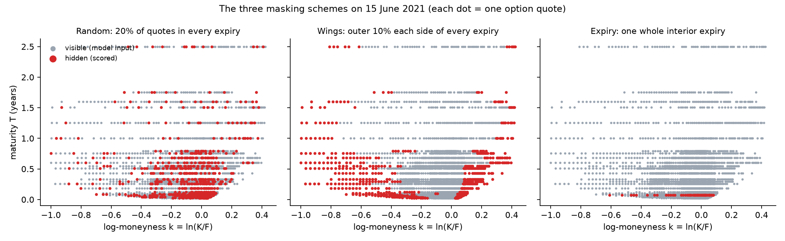
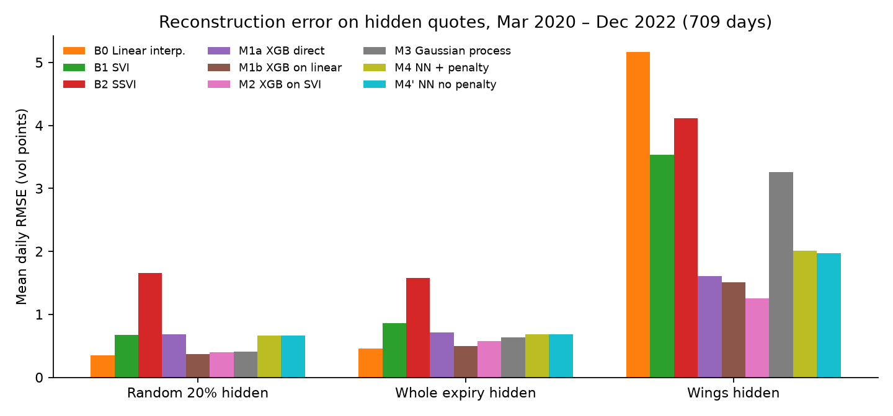
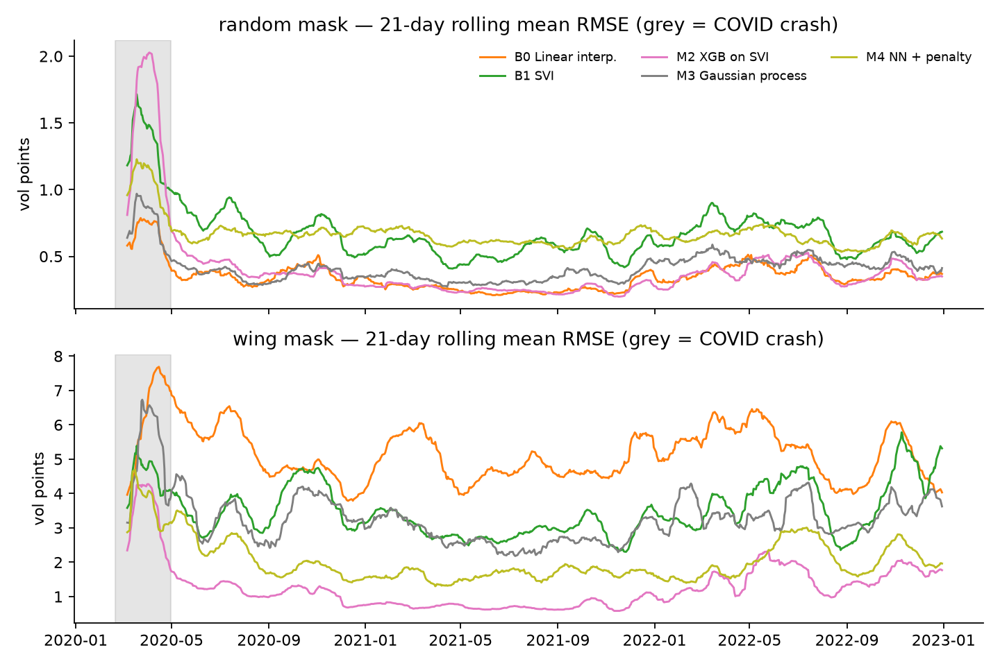
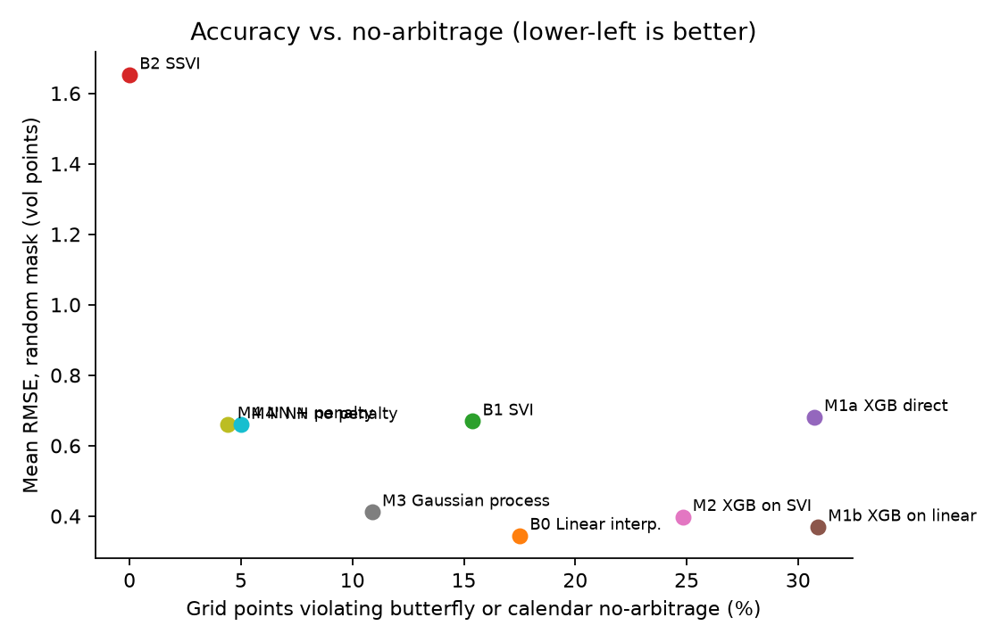
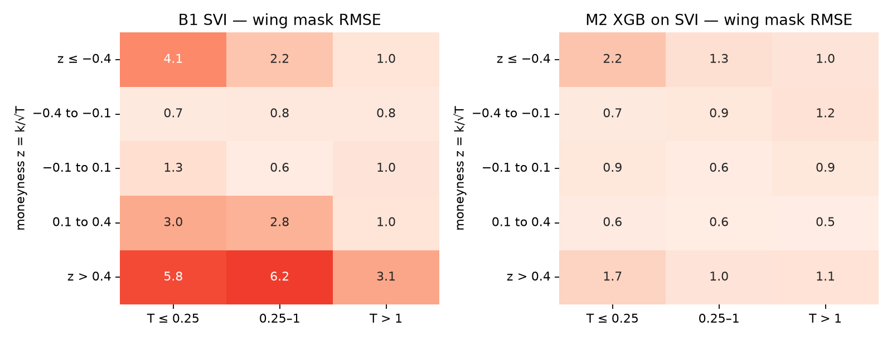

# Machine Learning for Implied Volatility Surface Reconstruction

**HST-105 Analytics for Business and Society · IIT Roorkee · Team: Aryan, Shachi, Shreekrushna**
Theme: *Risk and Stability of Markets*

> **Research question.** On any trading day only some option strikes and expiries trade, yet a
> trading desk needs an implied volatility (IV) at *every* point to price, hedge and measure risk.
> **Can machine learning reconstruct the SPY implied volatility surface more accurately than SVI,
> the formula used in industry — and does any gain hold up during market crises?**

This repository contains everything needed to reproduce every number, table and figure of the
final report, from the raw Kaggle file to the Word report.

**Online:** <https://github.com/Skecon/Project-files> — all code and all results, including the prediction files.

---

## Contents

1. [Answer in brief](#1-answer-in-brief)
2. [Why this is not a standard ML problem](#2-why-this-is-not-a-standard-ml-problem)
3. [Repository structure](#3-repository-structure)
4. [Setup](#4-setup)
5. [Data](#5-data)
6. [Reproducing the results](#6-reproducing-the-results)
7. [Pipeline: from raw file to features](#7-pipeline-from-raw-file-to-features)
8. [Evaluation design](#8-evaluation-design)
9. [Models](#9-models)
10. [Results](#10-results)
11. [Outputs explained](#11-outputs-explained)
12. [Randomness and reproducibility](#12-randomness-and-reproducibility)
13. [Troubleshooting](#13-troubleshooting)
14. [Limitations](#14-limitations)
15. [References](#15-references)

---

## 1. Answer in brief

We hide option quotes whose IV we know, ask each model to predict them from the remaining quotes,
and score the predictions. Over **709 test days (March 2020 – December 2022)**, three ways of hiding
quotes, and **10 models**:

| Model | Random 20% hidden | Whole expiry hidden | Wings hidden |
|---|---|---|---|
| B1 **SVI (industry benchmark)** | 0.67 | 0.86 | 3.53 |
| B0 Linear interpolation | **0.35** | **0.46** | 5.16 |
| M2 **XGBoost correcting SVI** | 0.40 | 0.57 | **1.25** |
| M4 Neural net + no-arbitrage penalty | 0.66 | 0.68 | 2.01 |
| M3 Gaussian process | 0.41 | 0.63 | 3.26 |

*Mean daily RMSE on hidden quotes, in volatility points (1 point = 0.01 IV). Full table in §10.*

- **Where machine learning wins — the wings** (strikes beyond the last quote, the hardest and most
  risk-relevant region): XGBoost correcting SVI cuts the error by **65%** (95% CI 61–68%,
  Diebold–Mariano p < 0.001, better on 99% of days).
- **Inside the observed range** plain linear interpolation already beats SVI by 48%; ML adds little.
- **Crisis:** an XGBoost model stays best in the wings in every regime, but learned models lose the
  most in the March 2020 crash (they had only two calm months of history).
- **Scarce data:** as more quotes are hidden (10% → 90%), the Gaussian process degrades least and
  becomes the best model; SVI's error grows 2.6×.
- **Consistency:** flexible models break no-arbitrage conditions more often; SSVI never does but is
  least accurate; the penalised neural net is the best compromise.
- **Hedging:** every model's one-day delta hedge is within ~3% of hedging with the true market IV.

---

## 2. Why this is not a standard ML problem

Our evaluation design follows from these features of the problem:

| Feature of the problem | Consequence for the design |
|---|---|
| The points we need (untraded strikes) have **no true value** | Self-supervised **hide-and-reconstruct**: hide quotes that *do* trade, predict, score |
| The unit is a **whole surface** (~2,700 linked quotes per day), not independent rows | Hiding happens **within each test day**; models see only that day's visible quotes (+ the past) |
| Gaps come in **different shapes** | **Three masks** (scattered, whole expiry, wings) and a **sparsity sweep** |
| Days are **dependent** and markets change regime | **Walk-forward** training (no future data); results **by regime** |
| A surface can fit well yet allow **riskless profit** | **Butterfly** and **calendar** no-arbitrage checks on every fitted surface |
| Daily errors are **heavy-tailed and autocorrelated** | Per-day errors, quantiles, **Diebold–Mariano** (Newey–West) and **block bootstrap** |
| Difficulty depends on **where** on the surface | **Regional** error grid (moneyness × maturity) |
| Two kinds of model (fit-per-day vs learn-from-history) | One interface, two protocols, both leakage-free |

Random k-fold cross-validation would leak information both across neighbouring quotes and across
neighbouring days; walk-forward evaluation is its time-series equivalent.

---

## 3. Repository structure

```
Project files/
├── README.md                 ← this file
├── requirements.txt          ← Python packages
├── config.yaml               ← every setting used (documentation; values live in the code, see comments)
├── PROJECT_STATUS.md         ← project log from the cleaning/feature stages
├── data/
│   ├── README.md             ← how to obtain the raw data, known data issues
│   ├── raw/                  ← spy_2020_2022.csv goes here (not in git)
│   └── processed/            ← parquet files created by the notebooks (not in git)
├── notebooks/
│   ├── 01_Cleaning.ipynb     ← raw CSV → clean types, bid/ask sizes, holiday removal, one row per option
│   ├── 02_Filters.ipynb      ← quality filters with removal log
│   ├── 03_Features.ipynb     ← forward price, k, T, w, out-of-the-money selection
│   ├── 04_Evaluation.ipynb   ← building and testing the evaluation framework
│   ├── 05_Models.ipynb       ← every model demonstrated on the 16 March 2020 crash day
│   └── 06_Analysis.ipynb     ← full analysis of the saved results
├── src/
│   ├── masking.py            ← random / wing / expiry masks, seeded by date
│   ├── evaluate.py           ← walk-forward evaluation loop, monthly training of learned models
│   ├── experiment.py         ← run one model on all masks, save results
│   ├── run_all.py            ← run every model + sparsity sweep (resumable)
│   ├── metrics.py            ← RMSE, MAE, max error, regional RMSE
│   ├── arbitrage.py          ← butterfly and calendar no-arbitrage checks
│   ├── stats.py              ← Diebold–Mariano test, block bootstrap, comparison vs SVI
│   ├── hedging.py            ← one-day delta-hedging test
│   ├── ml_features.py        ← features for learned models (visible quotes only) + training table
│   ├── regimes.py            ← market regimes
│   └── models/
│       ├── base.py           ← common interface: fit(visible, history) → predict(k, T)
│       ├── dummy.py          ← mean IV (floor)
│       ├── interp.py         ← B0 linear interpolation
│       ├── svi.py            ← B1 SVI (benchmark)
│       ├── ssvi.py           ← B2 SSVI
│       ├── xgb.py            ← M1a / M1b / M2 XGBoost
│       ├── gp.py             ← M3 Gaussian process
│       └── nn.py             ← M4 / M4' neural network (with / without penalty)
├── results/                  ← one folder per model + sparsity.csv + run_log.txt (all included)
└── report/
    ├── build_figures.py      ← results → report/tables/*.csv and report/figures/res_*.png
    ├── make_report.py        ← tables + figures → automatic draft report
    ├── make_handoff.py       ← package for the report writer (no raw data)
    ├── HANDOFF_CLAUDE.md     ← full written context of the project
    ├── figures/              ← fig_* (EDA, Phase 1) and res_* (results)
    ├── tables/               ← all result tables as CSV
    └── Final_Report_updated.docx ← automatic draft report (superseded by the submitted Phase 2 report)
```

---

## 4. Setup

Tested with **Python 3.12.10** on Windows 11 (Intel i5-13450HX, 10 cores, 24 GB RAM, no GPU used):
pandas 2.3.3 · numpy 2.5.0 · scipy 1.16.3 · scikit-learn 1.9.0 · xgboost 3.3.0 · torch 2.15 (CPU) ·
pyarrow 25.0 · joblib 1.5.3.

```bash
python -m venv .venv
.venv\Scripts\activate          # macOS/Linux: source .venv/bin/activate
pip install -r requirements.txt
```

About **16 GB RAM** is enough. A GPU is not needed: models are small and fitted per day, and the
code runs ~16 days in parallel on the CPU instead.

---

## 5. Data

**Source:** Kaggle dataset *"SPY Option Chains Q1 2020 – Q4 2022"* by kylegraupe (public;
end-of-day option chains of SPY, the S&P 500 ETF; one snapshot per trading day at 16:00):
<https://www.kaggle.com/datasets/kylegraupe/spy-daily-eod-options-quotes-2020-2022>
Download, unzip, and place the file at `data/raw/spy_2020_2022.csv`.

**Check you have the identical file:**

| Property | Expected |
|---|---|
| File size | 1,279,073,052 bytes (1.28 GB) |
| SHA-256 | `28a28c48af986f4aa6f140935e08d594ee7b2b6780142ee831a8797439e7f043` |
| Rows × columns | 3,589,079 × 33 |
| Quote dates | 2020-01-02 to 2022-12-30 (758 dates) |

```bash
sha256sum data/raw/spy_2020_2022.csv          # Windows PowerShell: Get-FileHash data\raw\spy_2020_2022.csv
```

Each raw row is one strike and expiry with **call and put side by side**: quote date, SPY price,
expiry, days to expiry, bid, ask, last, volume, bid/ask size (`"955 x 596"`), IV and Greeks for the
call (`C_*`) and the put (`P_*`). Known issues (9 stale holiday snapshots, 7 missing trading days)
are in [data/README.md](data/README.md).

---

## 6. Reproducing the results

### Quick path — results already computed
All model results are included in `results/` (162 MB). To rebuild the tables, figures and
report from them, only step 5 needs the processed data; to explore the results directly,
open `notebooks/06_Analysis.ipynb` or read `results/<model>/scores.csv` and `preds.parquet`.

### Full path (from the raw file)

Run every command from the project folder (`Project files/`).

| # | What | How | Creates | Time* | Check |
|---|---|---|---|---|---|
| 1 | Clean | run `notebooks/01_Cleaning.ipynb` | `data/processed/raw.parquet`, `options_long.parquet` | ~1 min | 749 days; 7,099,618 option rows |
| 2 | Filter | run `notebooks/02_Filters.ipynb` | `data/processed/options_filtered.parquet` | ~30 s | 3,391,881 rows |
| 3 | Features | run `notebooks/03_Features.ipynb` | `data/processed/options_features.parquet` | ~20 s | 2,017,522 rows, 749 days |
| 4 | All models | `python -m src.run_all` | `data/processed/ml_train_table.parquet`, `results/<model>/`, `results/sparsity.csv`, `results/run_log.txt` | ~5–6 h | log ends with `all done` |
| 5 | Tables & figures | `python report/build_figures.py` | `report/tables/*.csv`, `report/figures/res_*.png` | ~5 min | 11 tables, 7 result figures |
| 6 | Draft report | `python report/make_report.py` | `report/Final_Report.docx`: an automatically generated draft with the same tables (the submitted Phase 2 report was written by the team from these results) | seconds | — |
| 7 | (optional) notebooks | run `05_Models.ipynb`, `06_Analysis.ipynb` | executed notebooks | ~3 min / ~1 min | — |

\*On the 10-core laptop above. Step 4 detail (16 parallel workers): mean 11 s · linear 22 s ·
SVI 32 min · SSVI 1.5 min · XGBoost 3.5 min each (XGB-on-SVI 44 min) · GP 54 min · NN 38 min ·
NN without penalty 5 min · sparsity sweep 25 min · plus ~10 min to build the XGBoost training table.

**Step 4 is resumable:** a model whose `results/<model>/scores.csv` already contains the arbitrage
columns is skipped, so the run can be stopped and restarted. To re-run one model, delete its
folder. To run a single model yourself:

```python
import sys; sys.path.append('.')
import numpy as np, pandas as pd
from src.experiment import run_experiment
from src.models.svi import SVIModel

df = pd.read_parquet('data/processed/options_features.parquet')
days = np.sort(df.loc[df['quote_date'] >= '2020-03-01', 'quote_date'].unique())
out = run_experiment(SVIModel, df, days, out_dir='results')
print(out['by_mask'])
```

---

## 7. Pipeline: from raw file to features

| Step | Rule | Rows after |
|---|---|---|
| Holiday snapshots removed | 9 dates in 2022 (Jan 17, Feb 21, Apr 15, May 30, Jun 20, Jul 4, Sep 5, Nov 24, Dec 26) whose prices are within cents of the previous close | 749 days |
| One row per option | calls and puts stacked, `type` column | 7,099,618 |
| IV present | | 6,716,737 |
| Traded that day | volume > 0 (untraded prices are filled in by the provider) | 4,002,007 |
| Valid bid | bid > 0 | 3,825,746 |
| No crossed quotes | ask > bid | 3,768,719 |
| Liquid enough | (ask − bid) / mid ≤ 0.5 | 3,634,144 |
| Plausible IV | 0.01 ≤ IV ≤ 2 | 3,573,138 |
| Not about to expire | days to expiry ≥ 7 | 3,391,881 (47.8%) |
| Forward available | put–call-parity forward could be fitted (see below) | −2.1% |
| Out-of-the-money, \|k\| ≤ 1 | puts with k < 0, calls with k ≥ 0 | **2,017,522** |

**Features:**
- **Forward price F** for each date and expiry, from put–call parity: fit
  `C_mid − P_mid = D·F − D·K` by least squares over near-the-money pairs (|K/S − 1| ≤ 5%, at least 3
  pairs); F = intercept / D. (F/S follows theory: below 1 for long maturities in 2020–21 when
  dividends exceeded rates, above 1 in 2022 when rates rose. D itself is unreliable and unused.)
- **Log-moneyness** `k = ln(K/F)`, **maturity** `T = days/365`, **total variance** `w = IV²·T`.
- **Out-of-the-money only:** the most liquid side, and the side least affected by early exercise
  (SPY options are American; see §14).

---

## 8. Evaluation design

### 8.1 Test days and masks (`src/masking.py`)
Test days: **2 Mar 2020 – 30 Dec 2022 (709 days)**. Each day, each mask hides some quotes; the model
is fitted on the rest and scored on the hidden ones only. Masks are **seeded by the date**, so every
model is tested on **exactly the same hidden quotes** (837,112 per model).

| Mask | Rule | Imitates | Hidden / visible per day |
|---|---|---|---|
| **Random** | 20% of quotes in every expiry; ≥ 5 stay visible per expiry | scattered untraded strikes (interpolation) | 544 / 2,176 |
| **Wing** | lowest 10% and highest 10% of strikes in every expiry; ≥ 5 stay visible | far strikes with no quote (extrapolation) | 544 / 2,176 |
| **Expiry** | one whole expiry, never the shortest or longest | a maturity with no trades (interpolation in T) | 93 / 2,628 |
| **Sparsity sweep** | random mask with 10/30/50/70/90% hidden, every 10th test day | thinner and thinner markets | — |



### 8.2 Walk-forward protocol (`src/evaluate.py`)
- **Per-day models** (linear, SVI, SSVI, GP, NN) are fitted from scratch on each test day's visible quotes.
- **Learned models** (XGBoost) are retrained at the start of every test month on **all earlier
  days only** (34 monthly folds), then used for each day of that month with that day's visible quotes
  as input. Their training examples come from past days masked the same way (seed 1 instead of 0):
  874,994 rows. Features are computed from visible quotes only.

### 8.3 Measures
| Measure | Definition | Code |
|---|---|---|
| RMSE, MAE, max error | on hidden quotes, vol points, per day then averaged; 5/50/95% quantiles | `metrics.py` |
| Regional RMSE | z = k/√T buckets (≤ −0.4, −0.4…−0.1, −0.1…0.1, 0.1…0.4, > 0.4) × T (≤ 0.25, 0.25–1, > 1) | `metrics.py` |
| Butterfly arbitrage | Gatheral–Jacquier g(k) < 0 on a 41-strike grid × all maturities of the day | `arbitrage.py` |
| Calendar arbitrage | total variance decreasing from one maturity to the next | `arbitrage.py` |
| Significance vs SVI | Diebold–Mariano on daily squared error (Newey–West, 5 lags); 95% moving-block bootstrap CI (10-day blocks); win rate | `stats.py` |
| Regimes | COVID crash 20 Feb–30 Apr 2020 · recovery rest of 2020 · calm 2021 · bear 2022 | `regimes.py` |
| Hedging | one-day delta hedge of each hidden option with model IV vs market IV (Black delta on F) | `hedging.py` |

---

## 9. Models

All models implement `fit(visible, history)` and `predict(k, T)` (`src/models/base.py`).

| Code | Model | How it works | Why it is included | File |
|---|---|---|---|---|
| — | Mean | day's average visible IV everywhere | floor every model must beat | `dummy.py` |
| B0 | Linear interpolation | Delaunay linear interpolation of total variance in (k, T); nearest outside | simplest non-parametric baseline | `interp.py` |
| B1 | **SVI** | raw SVI `w = a + b(ρ(k−m) + √((k−m)² + σ²))` per expiry, SLSQP, Lee wing and positivity constraints; linear in T between expiries | the industry standard and Phase 1 benchmark | `svi.py` |
| B2 | SSVI | one surface per day; shared ρ, η, γ; ATM variance θ forced to rise with T; butterfly conditions as penalties | arbitrage-free version of the benchmark | `ssvi.py` |
| M1a | XGBoost direct | trees predict IV from 14 visible-quote features | learn from hundreds of past surfaces | `xgb.py` |
| M1b | XGBoost on linear | trees predict the error of linear interpolation | residual learning on the best simple baseline | `xgb.py` |
| M2 | XGBoost on SVI | trees predict the error of SVI (cf. Audrino & Colangelo 2010) | correct the benchmark's systematic errors | `xgb.py` |
| M3 | Gaussian process | smile trend in z + Matérn 5/2 GP on residuals; kernel by max. likelihood each day; ≤ 800 points | flexible Bayesian smoother with uncertainty | `gp.py` |
| M4 | Neural net + penalty | `w = w_SSVI · exp(MLP(k, T))`, 2×32 tanh; butterfly + calendar penalties via autograd (Deep Smoothing, Ackerer et al. 2020) | flexibility with no-arbitrage built into training | `nn.py` |
| M4′ | Neural net, no penalty | same, penalty weight 0 | ablation: what does the penalty buy? | `nn.py` |

XGBoost features (all from visible quotes): k, T, √T, z = k/√T, ATM IV at T, ATM IV at 30 days,
term slope, skew, distance to nearest visible expiry, whether the expiry is visible, distance to
nearest visible strike, distance beyond the lowest/highest visible strike, linear estimate
(+ SVI estimate for M2). Settings: 500 trees, depth 6, learning rate 0.05, subsample 0.8,
column sample 0.8, min child weight 20.

---

## 10. Results

### Accuracy (mean daily RMSE, vol points)

| Model | Random | Expiry | Wing |
|---|---|---|---|
| Mean (floor) | 11.67 | 10.96 | 20.37 |
| B0 Linear | **0.345** | **0.461** | 5.16 |
| B1 SVI | 0.670 | 0.856 | 3.53 |
| B2 SSVI | 1.65 | 1.57 | 4.12 |
| M1a XGBoost direct | 0.682 | 0.709 | 1.60 |
| M1b XGBoost on linear | 0.369 | 0.498 | 1.51 |
| M2 XGBoost on SVI | 0.398 | 0.574 | **1.25** |
| M3 Gaussian process | 0.412 | 0.632 | 3.26 |
| M4 NN + penalty | 0.661 | 0.683 | 2.01 |
| M4′ NN no penalty | 0.659 | 0.685 | 1.97 |



### Significance against SVI (wing mask)
| Model | Improvement | 95% CI | DM p-value | Days better |
|---|---|---|---|---|
| M2 XGBoost on SVI | −65% | 61–68% | < 0.001 | 99% |
| M1b XGBoost on linear | −57% | 52–62% | < 0.001 | 98% |
| M1a XGBoost direct | −55% | 40–64% | 0.042 | 96% |
| M4 NN + penalty | −43% | 39–47% | < 0.001 | 96% |
| M3 Gaussian process | −8% | 1–12% | 0.35 | 60% |

All masks: `report/tables/significance_vs_svi.csv`.

### Market regimes (wing mask)
| Model | COVID crash | Recovery 2020 | Calm 2021 | Bear 2022 |
|---|---|---|---|---|
| B1 SVI | 4.36 | 3.61 | 2.96 | 3.93 |
| M1a XGBoost direct | 7.39 | 1.44 | 0.97 | **1.35** |
| M2 XGBoost on SVI | **2.99** | **1.11** | **0.74** | 1.56 |
| M4 NN + penalty | 3.51 | 2.06 | 1.64 | 2.08 |



### Sparsity (random mask, every 10th test day)
| Hidden | GP | Linear | NN | SSVI | SVI | XGB on SVI |
|---|---|---|---|---|---|---|
| 10% | 0.43 | **0.35** | 0.65 | 1.69 | 0.67 | 0.41 |
| 50% | **0.42** | 0.46 | 0.68 | 1.67 | 0.75 | 0.46 |
| 90% | **0.68** | 1.24 | 0.90 | 1.78 | 1.75 | 0.94 |

### No-arbitrage (share of grid points violating, random mask)
| | SSVI | NN + penalty | NN no penalty | SVI | GP | Linear | XGB on SVI | XGB direct |
|---|---|---|---|---|---|---|---|---|
| Butterfly | 0% | 0.6% | 1.0% | 1.1% | 6.0% | 15.6% | 16.3% | 25.0% |
| Calendar | 0% | 3.8% | 4.0% | 14.3% | 4.9% | 1.9% | 8.5% | 5.7% |



### Where the errors are (wing mask)


---

## 11. Outputs explained

Each `results/<model>/` folder contains:

| File | Content |
|---|---|
| `scores.csv` | one row per day × mask: RMSE, MAE, max error, hidden/visible counts, butterfly/calendar rates and sizes, regime |
| `preds.parquet` | every hidden quote: date, mask, expiry, strike, type, k, T, true IV, predicted IV, regime |
| `summary_by_mask.csv` | mean of the daily scores per mask |
| `summary_by_regime.csv` | mean RMSE per regime × mask |
| `regional_<mask>.csv` | RMSE by moneyness × maturity bucket |

All of these are included in the repository. Also: `results/sparsity.csv` (sweep),
`results/run_log.txt` (timings and summary per model),
`report/tables/*.csv` (all report tables), `report/figures/res_*.png` (result figures).

---

## 12. Randomness and reproducibility

- **Masks:** seed = date as YYYYMMDD + 0 (tests) or + 1 (XGBoost training examples) → identical
  across models and runs.
- **GP subsample:** seeded by date. **Neural net:** `torch.manual_seed` from the date.
- **XGBoost:** deterministic given the data (`tree_method='hist'`).
- **Walk-forward:** a model tested in month *m* has seen only days before the first day of *m*.
- **Tested from a clean copy:** notebooks 01–03 rebuild `options_features.parquet` with every value
  identical to the file the results were computed on, and re-running the models on sample days
  reproduces the submitted daily scores.
- **Number of parallel workers.** SVI and the neural network use numerical optimisers whose last
  digits depend on how many CPU threads each parallel worker gets. The results were produced with
  16 workers (`n_jobs=-1` on a 16-thread CPU); with 16 workers a re-run matches them exactly.
  With a different number of workers a few days can differ for these two models (in our test by
  up to 0.17 vol points on one day). To match exactly on another machine, pass `n_jobs=16` to
  `run_experiment` in `src/run_all.py`. Linear interpolation, the GP, SSVI and XGBoost reproduce
  exactly or to within 0.02 vol points with any worker count.

---

## 13. Troubleshooting

| Problem | Fix |
|---|---|
| `FileNotFoundError ... ml_train_table.parquet` | run `python -m src.run_all` (it builds the table first) or `src.ml_features.build_training_table` |
| Run is much slower than the timings above (CPU ~25%) | Windows may put a hidden background process on efficiency cores. Run in a visible terminal and set *Settings → System → Power → Best performance* while plugged in |
| Run stopped half-way | restart `python -m src.run_all`; finished models are skipped |
| `PermissionError` saving the report | the .docx is open in Word; close it (the script then saves `_updated.docx`) |
| Notebook cannot import `src` | notebooks add `..` to `sys.path`; start Jupyter from the project folder or `notebooks/` |
| Out of memory | close other programs; set `n_jobs` in `run_experiment` lower than 16 |

---

## 14. Limitations

- IVs are computed by the data provider. SPY options are American; put and call IVs at the same
  strike differ by up to 0.5 points in late 2022 (high rates). We use out-of-the-money options only.
- One underlying, three unusually turbulent years.
- XGBoost and neural-network settings were chosen by hand, not tuned on a validation set
  (nested walk-forward tuning is future work); one random mask draw per day.
- In March 2020 the learned models had only 40 days of history.
- Arbitrage is checked on a finite grid; the hedging test ignores discounting and costs.

An independent team run of the GP and neural network with harsher masks (30% random, 30% of expiries,
15% wings) and different filters (758 days, 2.45 M quotes) found the same pattern; its numbers are
not comparable with the tables above and are reported separately in the final report.

---

## 15. References

- Ackerer, Tagasovska & Vatter (2020). *Deep smoothing of the implied volatility surface.* NeurIPS 33.
- Audrino & Colangelo (2010). *Semi-parametric forecasts of the implied volatility surface using regression trees.* Statistics and Computing 20.
- Carr & Wu (2010). *Stock options and credit default swaps: a joint framework for valuation and estimation.* Journal of Financial Econometrics 8(4).
- Chataigner, Cousin, Crépey, Dixon & Gueye (2021). *Beyond surrogate modeling: learning the local volatility via shape constraints.* SIAM J. Financial Mathematics 12.
- De Spiegeleer, Madan, Reyners & Schoutens (2018). *Machine learning for quantitative finance.* Quantitative Finance 18(10).
- Diebold & Mariano (1995). *Comparing predictive accuracy.* J. Business & Economic Statistics 13(3).
- Gatheral & Jacquier (2014). *Arbitrage-free SVI volatility surfaces.* Quantitative Finance 14(1).
- Zheng, Yang & Chen (2021). *Incorporating prior financial domain knowledge into neural networks for implied volatility surface prediction.* KDD 2021.
- *Volatility surface reconstruction using deep learning under no-arbitrage constraints* (2026). arXiv:2605.24031.

The full literature survey (10 papers, one page each) is in the appendix of the final report.
